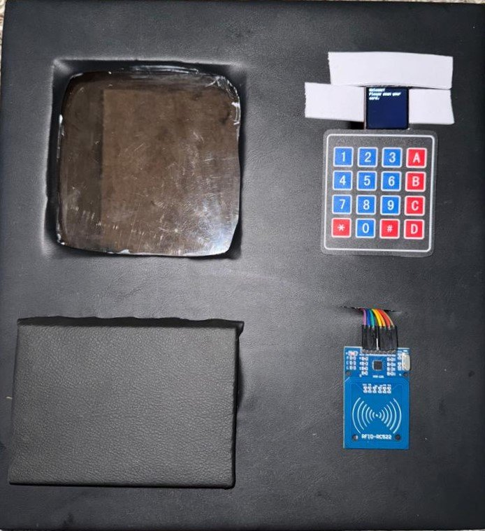
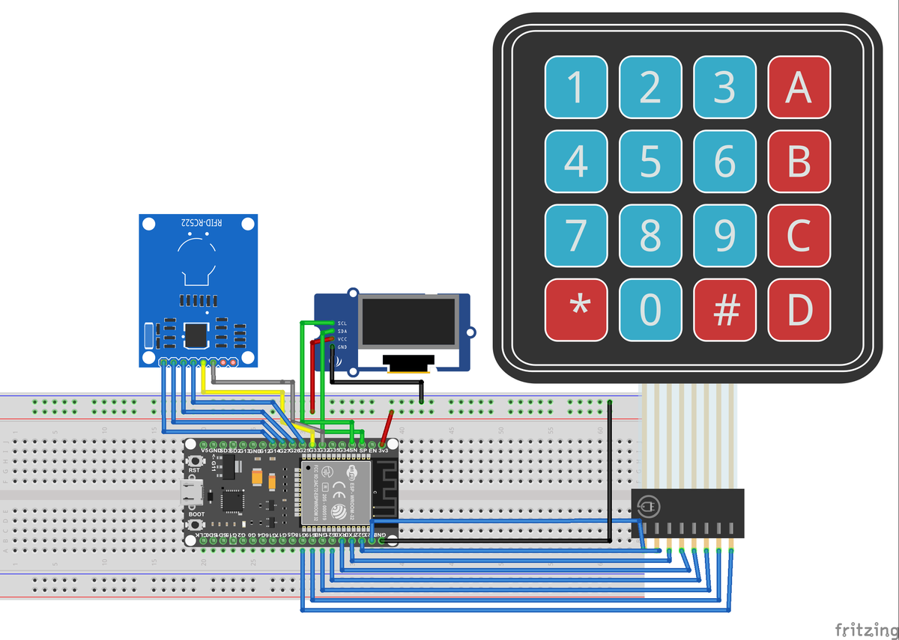

# RFID Vending Machine

A vending machine payment system with prepaid RFID cards, built on an ESP32-S3.

- Students pay with an RFID card that holds credit.
- They choose a product with a keypad and confirm on the screen.
- An admin card opens a menu to add students, add credit and see the sales.
- All data is saved in the ESP32 flash as JSON files. No PC or internet is needed.

<p align="center">
  
</p>

---

## 1. Get the code

```bash
git clone https://github.com/AbdouNaili/RFID-Vending-Machine.git
cd RFID-Vending-Machine
```

Or click **Code → Download ZIP** on GitHub.

---

## 2. What you need

**Hardware**

- ESP32-S3 board
- MFRC522 RFID reader + MIFARE cards
- SPI TFT screen (ST7789 240x240 in this project)
- 4x4 membrane keypad

**Software**

- Arduino IDE 2
- ESP32 boards by Espressif (*Tools → Board → Boards Manager*, search "esp32")
- Libraries (*Tools → Manage Libraries*):
  - **MFRC522** by GithubCommunity
  - **TFT_eSPI** by Bodmer
  - **ArduinoJson** by Benoit Blanchon, version **7**
  - **Keypad** by Mark Stanley and Alexander Brevig

---

## 3. Wiring

**RFID reader (MFRC522)**

| MFRC522 | ESP32-S3 |
|---|---|
| VCC | 3.3V |
| GND | GND |
| SDA (SS) | 15 |
| SCK | 18 |
| MOSI | 17 |
| MISO | 16 |
| RST | 7 |

**Screen**

| Screen | ESP32-S3 |
|---|---|
| VCC | 3.3V |
| GND | GND |
| SDA (MOSI) | 11 |
| SCL (SCK) | 12 |
| DC | 5 |
| RES (RST) | 4 |

**Keypad** (pins from left to right on the keypad cable)

| Keypad | R1 | R2 | R3 | R4 | C1 | C2 | C3 | C4 |
|---|---|---|---|---|---|---|---|---|
| ESP32-S3 | 1 | 2 | 42 | 41 | 40 | 39 | 38 | 36 |

Some ESP32-S3 boards (with "R8" in the name, like N16R8) use pins 35, 36 and 37 for their memory. On those boards, move the keypad wire from pin 36 to a free pin and change `colPins` in the code.

<details>
<summary>Wiring diagram of the first version (classic ESP32 + OLED)</summary>

<br>



This diagram is from an earlier version with a classic ESP32 and a small I2C OLED screen. **The final version uses an ESP32-S3 and an SPI TFT screen: follow the pin tables above, not this picture.**

</details>

---

## 4. Set up the screen

TFT_eSPI takes its pin settings from its own folder, not from the sketch.

1. Open your Arduino libraries folder (`Documents/Arduino/libraries/TFT_eSPI`).
2. Replace `User_Setup.h` with `firmware/TFT_eSPI_User_Setup.h` (rename it to `User_Setup.h`).
3. If your screen is not an ST7789 240x240, change the driver and size at the top of the file.

The file contains `#define USE_HSPI_PORT`. Keep it: the screen and the RFID reader use different SPI pins, so they need separate SPI ports.

---


## 5. Add your own cards

The sample data uses fake card UIDs, so your cards will show "User not found" at first.

1. Open the Serial Monitor and scan your card. It prints `Card: 12 34 56 78`.
2. Put that UID as the admin in `create_database.ino`, then upload `create_database` and `vending_machine` again.
3. Scan the admin card and choose **1. Add Student** to add the other cards.

---

## How to use

**Student**

1. Scan your card. The screen shows your name and credit.
2. Type the 2-digit product number (for example `15`). Press `C` to clear, or `0` to exit.
3. The screen shows the product and price. Press `A` to buy or `C` to go back.
4. The price is taken from your credit, the stock goes down by one, and the sale is saved.

**Admin** (scan the admin card)

| Key | Action |
|---|---|
| 1 | Add student: scan the new card, then type name, matricule, email and credit in the Serial Monitor |
| 2 | Add credit: scan the student card, type the amount, press `A` |
| 3 | Show all students (1 = next, 0 = return) |
| 4 | Show transactions (1 = next page, 0 = exit) |
| 0 | Exit |

---

## Data files

The files are stored in the ESP32 flash:

| File | Content |
|---|---|
| `Admin.json` | `UID`, `name`, `email` |
| `Students.json` | `UID`, `name`, `matricule`, `email`, `credit` |
| `Products.json` | `product_id` (2 digits), `name`, `price`, `quantity` |
| `Transactions.json` | `UID`, `product_id`, `price` |

To change the products, edit `create_database.ino` and upload it again.

---

## Troubleshooting

| Problem | Fix |
|---|---|
| "File system error" on the screen | Upload `create_database` first |
| Black or wrong screen | Check `User_Setup.h` in the TFT_eSPI folder (driver, pins) |
| Cards are not read | Check the RFID wiring and use 3.3V, not 5V |
| "User not found" | The card UID is not in the database (see step 6) |
| Keypad keys wrong | The keypad cable is reversed, or pin 36 is used by the board memory (see Wiring) |
